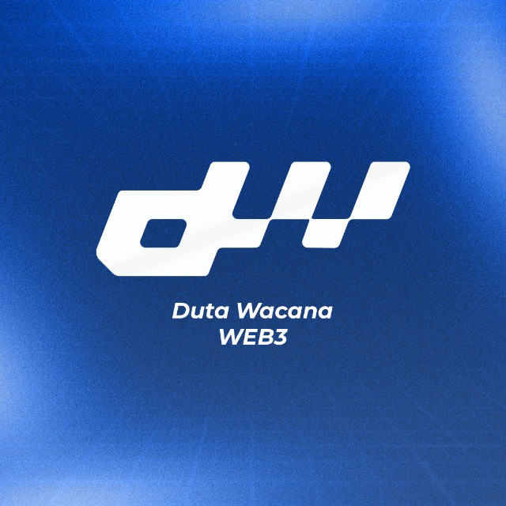

<p align="center">
  
</p>

<p align="center">
  <a href="https://bccukdw.xyz"></a>
  <a href="https://www.instagram.com/dutawacana.web3/"></a>
</p>

# UG Blockchain Challenges

Kumpulan challenge **audit smart contract** **UG (Unguided)** dari **BCC UKDW — Duta Wacana Web3**, terbuka untuk mahasiswa maupun publik.

Seluruh challenge di repo ini disusun berdasarkan materi **[Cyfrin Updraft — Smart Contract Security](https://updraft.cyfrin.io/courses/security)**. Setiap challenge memetakan satu section Updraft ke sebuah kontrak baru yang **orisinal**, sehingga kamu tidak bisa sekadar menyalin laporan audit yang sudah beredar.

Tujuannya melatih kamu **berpikir seperti security researcher**: membaca kode secara curiga, merumuskan aturan yang seharusnya selalu benar, lalu membuktikan pelanggarannya dengan test.

> **Unguided** artinya kamu tidak akan disuapi jawaban. Kamu akan diberi materi, arah, dokumentasi, dan petunjuk bertingkat. Sisanya harus kamu kerjakan sendiri. Benar atau tidaknya pekerjaanmu ditentukan oleh **test case otomatis** (`check.sh`).

### 🚦 Mulai di sini

> 🆕 **Baru pertama kali belajar web3?** Ikuti [**guidelines.md**](./guidelines.md): panduan langkah demi langkah dari nol sampai selesai, dengan bahasa yang ramah pemula.

1. Baca [**Aturan Utama**](#️-aturan-utama--wajib-dibaca), terutama aturan penggunaan AI.
2. Ikuti [**Instalasi**](#️-instalasi-cukup-sekali) langkah 1–6 (cukup sekali).
3. Coba [**Pemanasan: test pertamamu**](#pemanasan-test-pertamamu) supaya terbiasa menulis dan menjalankan test.
4. Buka [**Challenge 01**](./ug-challenge/ug-challenge-1/) dan kerjakan berurutan sampai Challenge 08.

---

## 🗺️ Daftar Challenge

Kerjakan **berurutan**. Setiap challenge mengandalkan skill dari challenge sebelumnya.

| No | Challenge | Section Cyfrin Updraft | Topik | Level | Status |
|---|---|---|---|---|---|
| 01 | [Vault Invariant Hunter](./ug-challenge/ug-challenge-1/) | Review | Stateless & stateful fuzzing, invariant, handler, analisis CEI | Beginner → Intermediate | ✅ Tersedia |
| 02 | [Secret Keeper](./ug-challenge/ug-challenge-2/) | Your First Audit (PasswordStore) | Access control, data `private` di storage, menulis finding & severity | Beginner | ✅ Tersedia |
| 03 | [Lucky Draw I](./ug-challenge/ug-challenge-3/) | Puppy Raffle | Reentrancy, mishandling ETH (`selfdestruct`) | Intermediate | ✅ Tersedia |
| 04 | [Lucky Draw II](./ug-challenge/ug-challenge-4/) | Puppy Raffle | DoS, weak randomness, unsafe casting, Slither & Aderyn | Intermediate | ✅ Tersedia |
| 05 | [Mini AMM](./ug-challenge/ug-challenge-5/) | TSwap | AMM `x * y = k`, invariant break, slippage, deadline | Intermediate | ✅ Tersedia |
| 06 | [Flash Lender](./ug-challenge/ug-challenge-6/) | Thunder Loan | Flash loan, deposit-instead-of-repay, oracle manipulation | Intermediate → Advanced | ✅ Tersedia |
| 07 | [Upgrade Trap](./ug-challenge/ug-challenge-7/) | Thunder Loan | Proxy, storage collision, failure to initialize, sentralisasi | Advanced | ✅ Tersedia |
| 08 | [Mini Bridge](./ug-challenge/ug-challenge-8/) | Boss Bridge | Arbitrary `from`, signature replay, EIP-712 | Advanced | ✅ Tersedia |
| 09 | [Lanjut Belajar](./ug-challenge/ug-challenge-9/) | — | Solodit, CodeHawks First Flights, Damn Vulnerable DeFi, dan langkah berikutnya | — | 📚 Bacaan |

---

## ⚠️ Aturan Utama — Wajib Dibaca

### 1. Tonton Cyfrin Updraft dulu

Setiap README challenge memiliki bagian **Part 0 — Wajib Tonton Cyfrin Updraft** berisi daftar lesson yang harus kamu tonton **sebelum** mengerjakan. Jangan dilewati. Tanpa konteks dari materi, kamu akan tersesat dan tergoda menyuruh AI mengerjakannya.

### 2. AI hanya boleh dipakai seperti Google, bukan sebagai programmer kamu

Kita belajar **menulis** smart contract dan test, bukan belajar **mem-prompt** smart contract. Auditor yang tidak bisa membaca dan menulis kode sendiri tidak akan bisa menemukan bug yang tidak diketahui AI.

| ✅ Boleh (AI sebagai mesin pencari / dokumentasi) | ❌ Dilarang (AI sebagai pengerja) |
|---|---|
| "Apa fungsi `vm.prank` di Foundry?" | "Buatkan fuzz test untuk fungsi deposit ini." |
| "Apa beda `bound()` dan `vm.assume()`?" | "Tulis handler invariant untuk SimpleVault." |
| "Apa itu pola Checks-Effects-Interactions?" | "Apa bug di kontrak ini?" (sambil menempel kode challenge) |
| "Arti error `Linearization of inheritance graph impossible`?" | "Perbaiki test saya sampai `check.sh` hijau." |
| "Tunjukkan link dokumentasi invariant testing di Foundry Book." | "Tuliskan laporan finding untuk bug ini." |
| "Jelaskan arti output `-vvvv` ini baris per baris." | Menyalin jawaban AI ke `ANSWERS.md` atau `FINDINGS.md`. |

**Aturan praktis:** kalau pertanyaanmu tetap masuk akal tanpa menempelkan kode challenge, kemungkinan besar pertanyaan itu boleh. Kalau kamu menempelkan kode challenge lalu meminta solusi, itu dilarang.

### 3. Setiap baris harus bisa kamu jelaskan

- Tulis alasan setiap assertion, `bound()`, `vm.prank()`, dan keputusan desain test di `ANSWERS.md`, **dengan kata-katamu sendiri**.
- Tim BCC UKDW dapat memintamu menjelaskan kode secara langsung. Contoh: *"Kenapa pakai `bound` di sini?"*, *"Apa yang terjadi kalau baris ini dihapus?"*, *"Tunjukkan di trace bagian mana invariant-nya dilanggar."*
- `check.sh` semua ✅ tetapi tidak bisa menjelaskan = **belum lulus**.

### 4. Kejujuran akademik

- Jangan menyalin pekerjaan peserta lain.
- Jangan men-decode `.check-data` (berisi kontrak pembanding) sebelum selesai. Itu sama saja dengan menyontek diri sendiri.
- Cantumkan sumber (artikel, video, dokumentasi) di bagian **Referensi** pada `ANSWERS.md`.
- Catat dengan jujur hint mana saja yang kamu buka. Membuka hint itu wajar.

---

## 🛠️ Instalasi (cukup sekali)

Ikuti langkah di bawah **berurutan**. Setiap langkah punya bagian **"Berhasil kalau…"** supaya kamu tahu apakah langkah itu sudah benar sebelum lanjut.

### Langkah 1 — Siapkan terminal

| OS | Yang dipakai |
|---|---|
| **macOS** | Aplikasi **Terminal** (cari "Terminal" di Spotlight). |
| **Linux** | Terminal bawaan. |
| **Windows** | **WSL (Ubuntu)**. Script `check.sh` dan Foundry berjalan paling lancar di WSL. |

**Khusus Windows:** buka **PowerShell sebagai Administrator**, lalu jalankan:

```powershell
wsl --install
```

Restart laptop, lalu buka aplikasi **Ubuntu** dari Start Menu dan buat username/password Linux. **Semua perintah berikutnya dijalankan di terminal Ubuntu ini**, bukan di PowerShell.

### Langkah 2 — Install Git dan curl

| OS | Perintah |
|---|---|
| macOS | `xcode-select --install` (kalau Git belum ada, akan muncul jendela instalasi) |
| Linux / WSL | `sudo apt update && sudo apt install -y git curl` |

**Berhasil kalau** `git --version` menampilkan versi, misalnya `git version 2.43.0`.

### Langkah 3 — Install Foundry

```bash
curl -L https://foundry.paradigm.xyz | bash
```

**Tutup terminal, lalu buka terminal baru** (supaya perintah `foundryup` dikenali), kemudian jalankan:

```bash
foundryup
```

**Berhasil kalau** `forge --version` menampilkan sesuatu seperti:

```text
forge Version: 1.x.x-stable
```

Dokumentasi resmi: <https://getfoundry.sh/introduction/installation>

### Langkah 4 — Clone repo ini

```bash
git clone --recurse-submodules --shallow-submodules https://github.com/BCC-UKDW-org/challenge-ug-blockchain.git
cd challenge-ug-blockchain
```

- `--recurse-submodules` **wajib**, karena library `forge-std` ikut diunduh lewat submodule.
- `--shallow-submodules` membuat unduhan lebih ringan (total ±15 MB).

Kalau sudah terlanjur clone tanpa flag tersebut, jalankan dari folder repo:

```bash
git submodule update --init --recursive --depth 1
```

> Mau menyimpan progres di GitHub milikmu sendiri? Fork repo ini lalu clone fork-mu. Ini opsional.

### Langkah 5 — Uji coba pertama

```bash
cd ug-challenge/ug-challenge-1
forge build
```

**Berhasil kalau** muncul `Compiler run successful!`. Saat pertama kali, Foundry akan mengunduh compiler Solidity (±10 MB), jadi tunggu sebentar.

```bash
forge test
```

**Normal kalau** muncul `No tests found in project!`, karena kamu belum menulis test.

```bash
./check.sh
```

**Normal kalau** semua ❌ dengan pesan "Fungsi ... tidak ditemukan", karena test-mu belum ada. Yang penting script-nya berjalan tanpa error.

### Langkah 6 — Buka di VS Code (disarankan)

```bash
code .
```

Pasang extension [Solidity (Juan Blanco)](https://marketplace.visualstudio.com/items?itemName=JuanBlanco.solidity) atau [Solidity (Nomic Foundation)](https://marketplace.visualstudio.com/items?itemName=NomicFoundation.hardhat-solidity) untuk syntax highlight. Pengguna Windows: pasang juga extension **WSL** supaya VS Code membuka folder di dalam Ubuntu.

✅ **Instalasi selesai.** Kamu tidak perlu mengulang langkah 1–6 untuk challenge berikutnya.

---

## 🧪 Cara Mengerjakan & Menguji

### Pemanasan: test pertamamu

Sebelum mengerjakan soal, pastikan kamu bisa menulis dan menjalankan satu test. Buka `ug-challenge/ug-challenge-1/test/SimpleVault.t.sol`, lalu tambahkan fungsi ini di bawah komentar `// TULIS TEST KAMU DI SINI`:

```solidity
function test_Pemanasan() public view {
    assertEq(vault.totalDeposits(), 0);
}
```

Jalankan:

```bash
forge test --match-test test_Pemanasan -vvv
```

**Berhasil kalau** muncul:

```text
[PASS] test_Pemanasan() (gas: ...)
```

Coba ganti `0` menjadi `1`, jalankan lagi, dan lihat seperti apa test yang **gagal** (`[FAIL]`). Setelah itu kembalikan ke `0` atau hapus fungsinya.

### Alur setiap challenge

```text
 Tonton Updraft (Part 0)  ─►  Tulis test di test/  ─►  forge test  ─►  ./check.sh A  ─►  Semua ✅?
                                      ▲                                                  │
                                      └───────────────── perbaiki ◄──────── tidak ───────┤
                                                                                         │ ya
                                                                                         ▼
                                                                              Lanjut Part B ...
```

1. **Tonton materi Part 0** yang tercantum di README challenge.
2. **Tulis test di folder `test/`.** File kerangka sudah tersedia. Kamu boleh menambah file baru di folder yang sama. **Jangan mengubah `src/`.**
3. **Jalankan test-mu** dengan `forge test` sampai perilakunya sesuai yang kamu harapkan.
4. **Cek jawaban** dengan `./check.sh <PART>`. Part mana saja yang dicek otomatis tercantum di README challenge. Part tanpa cek otomatis (misalnya recon atau laporan) cukup dikerjakan di `ANSWERS.md` / `FINDINGS.md`.
5. **Tulis penjelasan** di `ANSWERS.md` dan laporan bug di `FINDINGS.md`.
6. **Semua ✅ dan penjelasan lengkap?** Lanjut ke part berikutnya.

### Perintah yang sering dipakai

Jalankan dari dalam folder challenge, misalnya `cd ug-challenge/ug-challenge-1`.

| Perintah | Kegunaan |
|---|---|
| `forge build` | Compile kontrak dan test. Jalankan kalau ragu kodenya sudah benar secara sintaks. |
| `forge test` | Menjalankan semua test. |
| `forge test --match-test NAMA -vvv` | Menjalankan satu test saja, dengan detail kalau gagal. |
| `forge test -vvvv` | Menampilkan **trace** lengkap: urutan panggilan fungsi dan alasan revert. |
| `./check.sh` | Mengecek semua part yang bisa dicek otomatis. |
| `./check.sh A` | Mengecek Part A saja (ganti `A` dengan part yang sedang dikerjakan). |

### Membaca hasil `forge test`

| Output | Artinya |
|---|---|
| `[PASS] nama_test()` | Semua assertion di test itu terpenuhi. |
| `[FAIL: assertion failed: 5 != 10] nama_test()` | Assertion gagal. Nilai kiri adalah hasil sebenarnya, nilai kanan adalah yang kamu harapkan. |
| `[FAIL: <pesan revert>] nama_test()` | Ada transaksi yang revert. Tambahkan `-vvvv` untuk melihat di baris mana. |
| `counterexample: calldata=... args=[...]` | Fuzzer menemukan input yang membuat test gagal. `args` adalah input tersebut. |

### Membaca hasil `./check.sh`

`check.sh` menjalankan test-mu terhadap **kontrak asli**, versi yang **sudah diperbaiki**, dan versi yang **sengaja dirusak**. Test yang benar harus lulus di versi yang benar dan gagal di versi yang rusak. Artinya, **test hijau saja tidak cukup**: test-mu juga harus bisa menangkap bug.

```text
── Part A: testFuzz_Deposit
   ✅ Lulus di kontrak asli (input nol & input besar sudah ditangani)
   ✅ Mendeteksi deposit yang lupa menambah totalDeposits
   ❌ Mendeteksi deposit yang mencatat saldo pengguna dengan salah

Hasil: 2 lulus, 1 gagal.
```

| Tanda | Artinya |
|---|---|
| ✅ | Bagian ini sudah benar. |
| ❌ "tidak ditemukan" | Nama fungsi test belum ada atau salah ketik. Cek tabel **nama test wajib** di README challenge. |
| ❌ lainnya | Test-mu ada, tetapi belum menguji hal yang benar. Baca pesannya, lalu buka hint di README challenge. |
| ℹ️ | Informasi saja, tidak memengaruhi hasil. |

> `check.sh` mengompilasi kontrak beberapa kali, jadi wajar kalau butuh 10–60 detik.

---

## 🧰 Tools yang Membantu Audit

Tidak wajib dipasang semuanya. Mulailah dari yang dipakai di challenge, lalu tambah seiring kebutuhan.

### Analisis & testing

| Tool | Kegunaan | Dipakai di |
|---|---|---|
| [Foundry](https://getfoundry.sh/) (`forge`, [`cast`](https://getfoundry.sh/cast/overview), [`chisel`](https://getfoundry.sh/chisel/overview)) | Compile, test, fuzz, invariant; `cast` untuk membaca storage/memanggil kontrak; `chisel` untuk mencoba Solidity secara interaktif | Semua challenge |
| [Slither](https://github.com/crytic/slither) | Static analysis: mendeteksi pola bug umum secara otomatis | UG-4 dan seterusnya |
| [Aderyn](https://github.com/Cyfrin/aderyn) | Static analysis buatan Cyfrin, menghasilkan laporan markdown | UG-4 dan seterusnya |
| [Solidity Visual Developer](https://marketplace.visualstudio.com/items?itemName=tintinweb.solidity-visual-auditor) | Extension VS Code: highlight state variable, call graph, anotasi audit | Semua challenge |
| [cloc](https://github.com/AlDanial/cloc) | Menghitung jumlah baris kode untuk scoping audit | Semua challenge |
| [Echidna](https://github.com/crytic/echidna) / [Medusa](https://github.com/crytic/medusa) | Fuzzer alternatif selain Foundry | Lanjutan |
| [Halmos](https://github.com/a16z/halmos) | Symbolic testing / formal verification dengan sintaks Foundry | Lanjutan |

### Utilitas sehari-hari

| Tool | Kegunaan |
|---|---|
| [Ethereum Unit Converter](https://eth-converter.com/) | Konversi wei ↔ gwei ↔ ether |
| [EthSum](https://ethsum.netlify.app/) | Checksum alamat Ethereum |
| [Swiss-Knife Calldata Decoder](https://calldata.swiss-knife.xyz/decoder) | Decode calldata transaksi menjadi fungsi dan argumen ([semua tools Swiss-Knife](https://swiss-knife.xyz/)) |
| [4byte Directory](https://www.4byte.directory/) | Mencari nama fungsi dari function selector |
| [evm.codes](https://www.evm.codes/) | Referensi opcode EVM beserta biaya gas |
| [JSON Crack](https://jsoncrack.com/editor) | Visualisasi JSON (ABI, output `forge inspect`, trace) |
| [Etherscan](https://etherscan.io/) | Membaca kontrak, transaksi, dan storage di mainnet |
| [Tenderly](https://tenderly.co/) | Simulasi dan debugging transaksi |
| [Synpress](https://docs.synpress.io/) | E2E testing dApp dengan MetaMask (untuk frontend web3) |

### Peta belajar

- [Ethereum-Jakarta/fullstack-web3-roadmap](https://github.com/Ethereum-Jakarta/fullstack-web3-roadmap): roadmap belajar fullstack web3 dari komunitas Indonesia.
- [Cyfrin Updraft — Smart Contract Security](https://updraft.cyfrin.io/courses/security) beserta [repo course-nya](https://github.com/Cyfrin/security-and-auditing-full-course-s23).

---

## 📚 Lanjut Belajar Setelah Repo Ini

Sudah menyelesaikan UG-1 sampai UG-8? Lanjutkan ke [**09 — Lanjut Belajar**](./ug-challenge/ug-challenge-9/): Solodit, CodeHawks First Flights, Damn Vulnerable DeFi, dan jalur menuju audit kompetitif.

Butuh database audit, laporan bug, checklist, atau CTF untuk latihan? Lihat [**resource-learn-audit**](./resource-learn-audit/): kumpulan sumber yang sudah dikelompokkan per kategori.

---

## 📁 Struktur Repositori

```text
challenge-ug-blockchain/
├── README.md                   ← kamu di sini (aturan, instalasi, cara menguji, tools)
├── guidelines.md               ← panduan langkah demi langkah untuk pemula
├── bcc-ukdw/                   ← aset logo
├── resource-learn-audit/       ← database audit, laporan bug, checklist, CTF
└── ug-challenge/               ← semua challenge ada di sini
    ├── scripts/
    │   ├── check-lib.sh        ← mesin cek yang dipakai semua check.sh
    │   └── variants.sh         ← khusus maintainer
    ├── ug-challenge-1/ … ug-challenge-8/   ← satu folder = satu challenge (proyek Foundry mandiri)
    │   ├── README.md           ← soal, materi wajib, hint
    │   ├── src/                ← kontrak yang diaudit (JANGAN diubah)
    │   ├── test/               ← tulis test-mu di sini
    │   ├── ANSWERS.md          ← penjelasanmu
    │   ├── FINDINGS.md         ← laporan bug
    │   ├── check.sh            ← cek jawaban: ./check.sh [PART]
    │   ├── .check-data         ← kontrak pembanding (base64)
    │   ├── foundry.toml
    │   └── lib/forge-std/      ← submodule
    └── ug-challenge-9/         ← Lanjut Belajar (hanya README)
```

---

## ❓ Troubleshooting

| Masalah | Solusi |
|---|---|
| `Source "forge-std/Test.sol" not found` | Submodule belum terunduh. Jalankan `git submodule update --init --recursive --depth 1`. |
| `forge: command not found` | Jalankan `foundryup`, lalu buka ulang terminal. |
| `./check.sh: Permission denied` | Jalankan `chmod +x check.sh`, atau pakai `bash check.sh A`. |
| `foundryup: command not found` setelah install | Tutup terminal lalu buka terminal baru. Kalau masih gagal, jalankan `source ~/.bashrc` (Linux/WSL) atau `source ~/.zshenv` (macOS). |
| `./check.sh` error `$'\r': command not found` atau `bad interpreter` di Windows | Repo di-clone dari PowerShell/Windows. Clone ulang **dari terminal Ubuntu (WSL)**. |
| `check.sh` bilang "Fungsi ... tidak ditemukan" | Nama fungsi test harus sama persis dengan tabel di README challenge. |
| `check.sh` bilang "gagal dikompilasi terhadap versi kontrak pembanding" | Test-mu memakai sesuatu yang bukan bagian publik kontrak. Pakai hanya fungsi publik yang ada di `src/`. |
| `check.sh` di Windows | Jalankan dari terminal **Ubuntu (WSL)**. Lihat [Langkah 1](#langkah-1--siapkan-terminal). |
| Bingung harus mulai dari mana | Tonton ulang materi di **Part 0** README challenge. |

---

## 🙏 Kredit

- Materi dan kurikulum: [Cyfrin Updraft](https://updraft.cyfrin.io/) oleh Patrick Collins dan tim Cyfrin.
- Disusun oleh BCC UKDW — Duta Wacana Web3 sebagai challenge UG (Unguided).

Selamat berburu bug. 🐛🔍
